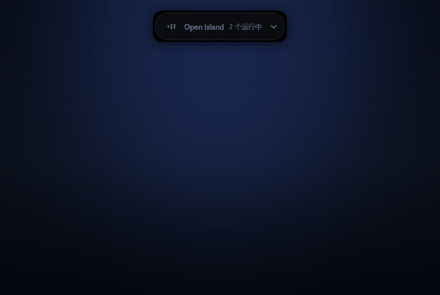
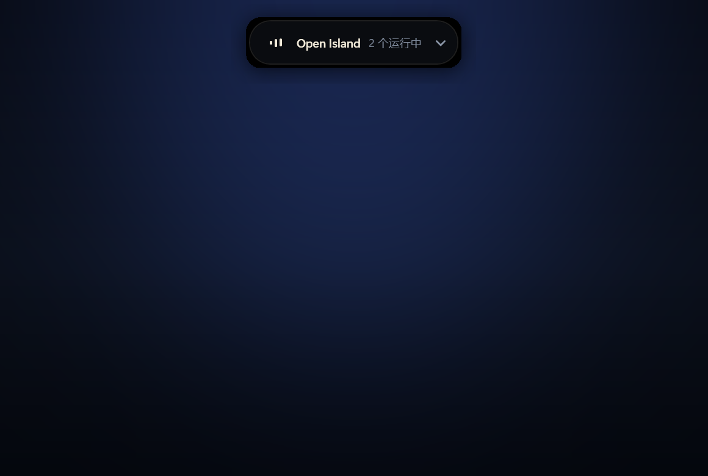
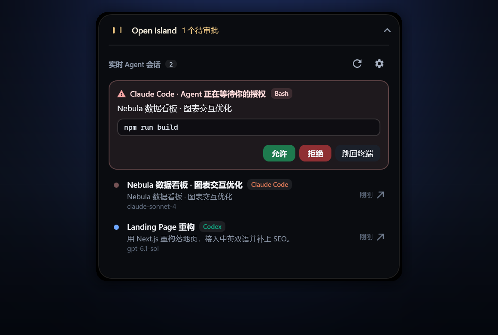
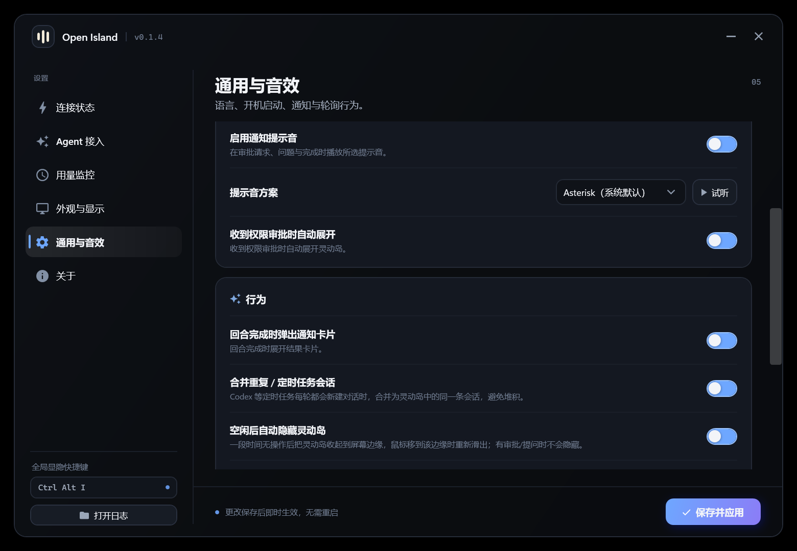
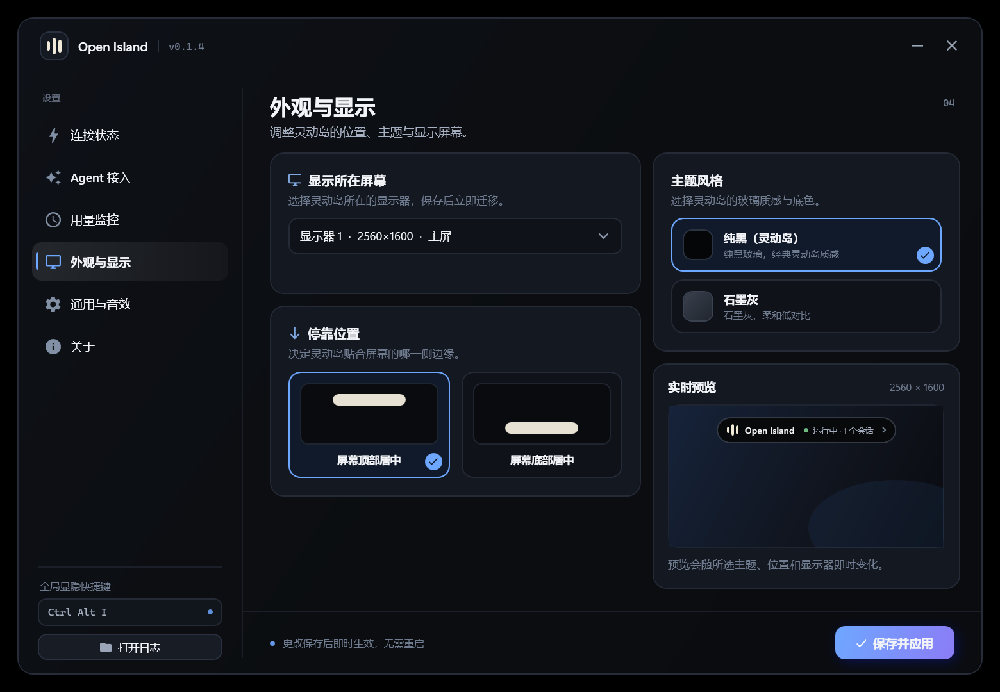

# Open Island — Windows 11 Port

<p align="center">
  <b>A Dynamic Island for AI coding agents, built for Windows 11</b><br/>
  <sub>This is the <b>Windows 11 port</b> of <a href="https://github.com/Octane0411/open-vibe-island">Octane0411/open-vibe-island</a>. The original macOS app is built with SwiftUI; this project re-implements its interaction model and visual language for Windows.</sub>
</p>

<p align="center">
  <a href="README.md">简体中文</a> · English
</p>

<p align="center">
  
</p>

<p align="center">
  
  
</p>

---

## What it is

Open Island puts the live state of your AI coding agents into a Dynamic Island at the top of the screen:

- who is running, which tool is being used, and the latest assistant message;
- when an agent needs **command approval or an answer**;
- when a turn completes;
- usage and rate-limit windows for supported agents.

It stays out of the taskbar, collapses into a small pill, and expands automatically when your attention is required.

> This project is not affiliated with OpenAI, Anthropic, Google or any agent vendor. Agent names and trademarks belong to their respective owners.

## Features

- **Live agent sessions**: Claude Code, Codex, OpenCode, Cursor, Gemini CLI, Kimi, Grok, Hermes, Pi, Oh My Pi, Qoder, Qwen Code, Factory, CodeBuddy, ZCode, and **DeepSeek Harness (DSH) auto-discovery** (no hooks required).
- **Approvals / questions / completions**: the island slides out and expands when you are asked to approve a command or answer a question, with notification sounds and an auto-expand toggle.
- **Click to jump back**: opens the exact Codex conversation via `codex://threads/<id>` (or `codex resume`), `claude --resume` for Claude, and focuses the DSH window for DeepSeek Harness.
- **Idle auto-hide**: tucks itself into the screen edge after a configurable idle period and slides back out when the pointer reaches that edge. It never hides while approvals/questions are pending.
- **Usage monitoring**: Claude Code 5-hour / 7-day limits and more.
- **Session de-duplication**: Codex scheduled tasks, subagent threads and Guardian reviews no longer pile up identical rows; recurring tasks are coalesced.
- **Safe hook installation**: Codex uses the official `hooks.json` format (compatible with the ChatGPT/Codex app), automatically migrates legacy configs, and never corrupts `config.toml`.
- **In-app auto-updates**: automatically checks GitHub Releases for new stable versions on startup, strictly verifies downloads against `SHA256SUMS.txt` (SHA-256), and supports both installed (silent in-place upgrade) and portable ZIP updates, with a Settings toggle and manual check.
- **Bilingual UI** (Chinese / English), dark themes, top/bottom docking, multi-monitor selection and a global `Ctrl+Alt+I` hotkey.

## Screenshots

| Island · approvals and multiple agents | Settings · Behaviour |
| --- | --- |
|  |  |

| Settings · Appearance |
| --- |
|  |

## Installation

**Requirements**: Windows 10 / Windows 11 x64.

1. Go to [Releases](https://github.com/zhengbaiyang/open-vibe-island-win11/releases) and download either:
   - `OpenIsland-Setup-0.1.4-win-x64.exe` — self-contained installer (no .NET runtime needed, per-user install);
   - `OpenIsland-0.1.4-portable-win-x64.zip` — portable build, extract and run.
2. The installer is unsigned. On first launch Windows SmartScreen may show “Windows protected your PC”:
   - Right-click the file → **Properties** → check **Unblock** → OK, then run it;
   - or download `OpenIsland-0.1.4-smartscreen-helper.zip` and follow `Unblock-and-Install.cmd`.
3. If the installer reports “Unable to create directory …\Temp\is-*.tmp (Error 5: Access is denied)”, your per-user temp folder is not writable. Use `Unblock-and-Install.cmd` from the helper zip (it redirects the installer temp folder), or use the portable ZIP.
4. Open **Settings → Agent connection** and click **Install / Repair** for the agents you use. If Codex asks to trust hooks, run `/hooks` once in Codex.

**Auto-updates**

- Open Island automatically checks GitHub Releases for new stable versions on startup. You can toggle **Auto-check for updates** under **Settings → General**, or trigger a manual check anytime from **Settings → About** or the tray menu (**Check for updates**).
- Every update package is strictly verified against `SHA256SUMS.txt` from the release before anything runs (missing or mismatched checksums are rejected).
- **Installed builds** run a silent in-place Inno Setup upgrade and relaunch automatically; **portable builds** verify, stage, replace the app directory, and relaunch; **development builds** open the GitHub Release page in your browser.

## Build & run

**Prerequisites**

- [.NET 8 SDK](https://dotnet.microsoft.com/download/dotnet/8.0)
- [Inno Setup 6](https://jrsoftware.org/isdl.php) (only for building the installer)
- Windows 10/11 SDK (optional, for code signing)

```powershell
git clone https://github.com/zhengbaiyang/open-vibe-island-win11.git
cd open-vibe-island-win11

# Development build (output -> dist\win-x64)
.\scripts\build.ps1

# Run
.\dist\win-x64\OpenIsland.exe

# Hooks
.\dist\win-x64\OpenIslandSetup.exe status
.\dist\win-x64\OpenIslandSetup.exe install claude
.\dist\win-x64\OpenIslandSetup.exe install codex
```

**Release artifacts**

```powershell
# Reads <Version> from Directory.Build.props by default (or override with -Version 0.1.5)
# Self-contained; target PCs do not need the .NET runtime
.\scripts\package.ps1 -PortableZip

# Outputs:
#   dist\OpenIsland-Setup-<version>-win-x64.exe
#   dist\OpenIsland-<version>-portable-win-x64.zip
#   dist\OpenIsland-<version>-smartscreen-helper.zip
#   dist\SHA256SUMS.txt
```

- **Manual release**: upload **all 4 files above — including `SHA256SUMS.txt`** — as GitHub Release assets. `SHA256SUMS.txt` is strictly required for in-app auto-updates.
- **Automated release (recommended)**: push a `vX.Y.Z` tag (e.g. `git tag v0.1.5 && git push origin v0.1.5`) or run the **Release** workflow (`.github/workflows/release.yml`) manually via `workflow_dispatch` to automatically build, package, verify checksums, and publish the GitHub Release with all 4 assets.

## Architecture

```
src/
  OpenIsland.App/       WPF island UI, settings window, tray
  OpenIsland.Core/      session state, hook protocol, discovery, install manager, bridge, auto-updater
  OpenIsland.Hooks/     agent hook CLI receiver
  OpenIsland.Setup/     OpenIslandSetup CLI (install / status / uninstall hooks)
plugins/                OpenCode / Pi / Oh My Pi extensions
installer/              Inno Setup script and icons
scripts/                build.ps1, package.ps1
.github/workflows/      GitHub Actions automated build & release workflow
docs/screenshots/       README screenshots and demo GIF
```

Agent events reach the app through the named pipe `\\.\pipe\open-island-bridge`; the UI consumes a single `SessionStateReducer`.

## Roadmap

- Consider adding more customizable display elements (media, date, weather, etc.).

## Credits & license

- Upstream project: [Octane0411/open-vibe-island](https://github.com/Octane0411/open-vibe-island) (macOS, SwiftUI).
- Licensed under **GNU GPL-3.0** — see [LICENSE](LICENSE).
- Thanks to all agent tool authors and the open-source community.

---

<p align="center"><sub>If this project helps you, a ⭐ is appreciated.</sub></p>
