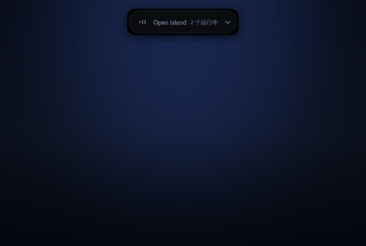
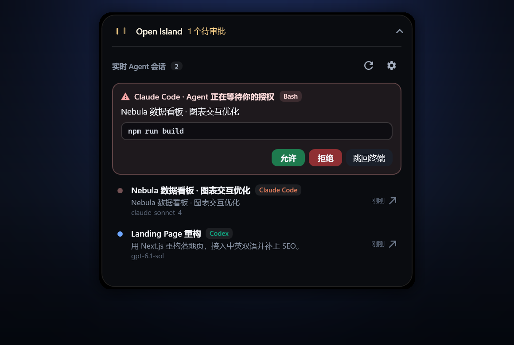

<div align="center">

# Open Island — Windows 11 版

**为 AI 编程 Agent 打造的 Windows 灵动岛控制中心**

<sub>
  <a href="https://github.com/Octane0411/open-vibe-island">Octane0411/open-vibe-island</a> 的 <b>Windows 11 原生移植版本</b>，基于 .NET 8 与 WPF 重新实现其交互与视觉语言。
</sub>

<p>
  <a href="https://github.com/zhengbaiyang/open-vibe-island-win11/releases/latest">
    
  </a>
  
  
  <a href="LICENSE">
    
  </a>
</p>

<p>
  <b>简体中文</b> · <a href="README.en.md">English</a>
  &nbsp;&nbsp;|&nbsp;&nbsp;
  <a href="#核心功能">核心功能</a> ·
  <a href="#界面预览">界面预览</a> ·
  <a href="#快速安装">快速安装</a> ·
  <a href="#支持的-agent">支持的 Agent</a> ·
  <a href="#从源码构建">从源码构建</a>
</p>

<br/>



<p>
  
  
</p>

</div>

---

## 为什么是 Open Island？

当你同时开着多个终端、IDE 或桌面端 AI 编程 Agent 跑任务时，最容易错过的是**等待命令审批、卡在提问、或者已经默默跑完**的瞬间。

Open Island 把所有活跃 Agent 的实时状态收纳进屏幕边缘的一枚「灵动岛」里：

- **一眼掌握全局**：谁在运行、正在调用什么工具、最新一条回复是什么；
- **不错过任何阻塞**：需要你**批准命令或回答问题**时主动滑出展开，并可伴随提示音；
- **一轮完成即刻知晓**：任务完成后弹出结果卡片，支持一键跳回对应终端或对话；
- **本地优先，零遥测**：所有会话状态、配置与额度缓存均仅在本机处理，不上传任何用户数据。

> [!NOTE]
> 本项目与 OpenAI、Anthropic、Google 等公司无隶属关系，所有 Agent 名称与商标归其各自所有者。

---

## 核心功能

| 能力 | 说明 |
| --- | --- |
| **实时多 Agent 会话** | 原生接入 15+ 主流 AI 编程工具，以及 **DeepSeek Harness（DSH）零配置自动发现**。 |
| **审批 / 提问 / 完成交互** | 待审批或待回答时灵动岛主动滑出并展开，支持直接在岛上响应与自定义 Windows 提示音。 |
| **一键跳回上下文** | Codex 直达 `codex://threads/<id>` 或 `codex resume`；Claude 支持 `claude --resume`；DSH 自动聚焦窗口。 |
| **空闲自动隐藏** | 无操作一段时间后轻柔收起到屏幕边缘，鼠标移至边缘即刻滑出；存在待审批/待提问时保持常显。 |
| **额度与用量监控** | 本地读取 Claude Code 等 5 小时 / 7 天额度窗口与重置时间，无需额外云端授权。 |
| **智能去重与安全 Hooks** | 自动合并 Codex 定时任务与重复会话，避免列表堆积；采用官方 `hooks.json` 规范，不破坏 `config.toml`。 |
| **应用内自动更新** | 启动自动检查 GitHub Releases 最新正式版，强制校验 `SHA256SUMS.txt`，支持安装版静默覆盖与便携版原地更新。 |
| **原生外观与系统集成** | 纯黑 / 石墨灰双主题、顶部 / 底部停靠、多显示器切换、中英双语、开机自启与全局显隐快捷键 `Ctrl+Alt+I`。 |

---

## 界面预览

| 灵动岛 · 审批与多 Agent 会话 | 设置 · 通用与音效 |
| :---: | :---: |
|  |  |

| 设置 · 外观与实时预览 |
| :---: |
|  |

---

## 支持的 Agent

<details open>
<summary><b>已支持 16 款 AI 编程 Agent（点击展开 / 收起）</b></summary>

- **托管 Hook / 插件接入（可在「设置 → Agent 接入」一键安装与修复）**：
  `Claude Code` · `Codex` · `OpenCode` · `Cursor` · `Gemini CLI` · `Kimi CLI` · `Grok Build` · `Hermes Agent` · `Pi` · `Oh My Pi (OMP)` · `Qoder` · `Qwen Code` · `Factory` · `CodeBuddy` · `ZCode Desktop`
- **零配置自动发现**：
  `DeepSeek Harness (DSH)`（无需安装 Hook，自动读取本机会话缓存并支持点击聚焦窗口）

</details>

---

## 快速安装

**系统要求**：Windows 10 / Windows 11（x64），安装包与便携版均自包含运行环境，无需预装 .NET。

1. 前往 [GitHub Releases](https://github.com/zhengbaiyang/open-vibe-island-win11/releases/latest) 下载任一版本：
   - **安装版（推荐）**：`OpenIsland-Setup-<版本>-win-x64.exe`（按当前用户安装，无需管理员权限）
   - **便携版**：`OpenIsland-<版本>-portable-win-x64.zip`（解压即用）
2. 启动后打开 **设置 → Agent 接入**，为正在使用的 Agent 点击 **安装 / 修复**。
   - 若 Codex 提示信任 Hook，在 Codex 中执行一次 `/hooks` 确认即可。

### 应用内自动更新

- 程序启动时会在后台自动检查 [GitHub Releases](https://github.com/zhengbaiyang/open-vibe-island-win11/releases) 最新正式版，并在发现新版本时展示更新日志与进度条。
- 所有更新包在安装前都会**强制校验 `SHA256SUMS.txt`（SHA-256）**，校验缺失或不匹配将直接拒绝执行。
- **安装版**支持静默覆盖升级并自动重启；**便携版**支持原地校验替换并自动重启。
- 你随时可以在 **设置 → 通用与音效** 开关「自动检查更新」，或在 **设置 → 关于** / 系统托盘菜单点击「检查更新」手动检测。

<details>
<summary><b>首次运行遇到 SmartScreen 提示或临时目录错误 5？</b></summary>

1. **Windows SmartScreen 提示「Windows 已保护你的电脑」**：
   - 由于安装包尚未使用商业 EV/OV 代码签名证书，首次下载后可右键安装包 → **属性** → 勾选 **解除锁定** → **确定**后再运行；
   - 或直接下载同版本中的 `OpenIsland-<版本>-smartscreen-helper.zip`，按内置说明运行 `Unblock-and-Install.cmd`。
2. **安装提示「无法创建目录 …\Temp\is-*.tmp（错误 5: 拒绝访问）」**：
   - 说明当前用户临时目录权限异常，使用助手包中的 `Unblock-and-Install.cmd`（会自动改用可写临时目录），或直接使用便携版 ZIP 即可。

</details>

---

## 从源码构建

**环境依赖**：[.NET 8 SDK](https://dotnet.microsoft.com/download/dotnet/8.0)

```powershell
git clone https://github.com/zhengbaiyang/open-vibe-island-win11.git
cd open-vibe-island-win11

# 开发构建（输出到 dist\win-x64）
.\scripts\build.ps1

# 启动应用
.\dist\win-x64\OpenIsland.exe

# 命令行检查 / 安装 Hooks
.\dist\win-x64\OpenIslandSetup.exe status
.\dist\win-x64\OpenIslandSetup.exe install claude
.\dist\win-x64\OpenIslandSetup.exe install codex
```

---

## 项目结构

```text
src/
  OpenIsland.App/       WPF 灵动岛 UI、设置窗口、更新弹窗与系统托盘
  OpenIsland.Core/      会话状态机、Hook 协议、自动发现、桥接服务与自动更新引擎
  OpenIsland.Hooks/     Agent Hook 命令行接收器
  OpenIsland.Setup/     OpenIslandSetup CLI（安装 / 检查 / 卸载 Hooks）
plugins/                OpenCode / Pi / Oh My Pi 扩展插件
installer/              Inno Setup 安装脚本与图标资源
scripts/                本地构建与打包脚本
.github/workflows/      GitHub Actions 自动化发布工作流
docs/screenshots/       演示动图与界面截图
```

> Agent 事件通过本地命名管道 `\\.\pipe\open-island-bridge` 实时推送至主进程，UI 统一消费单一 `SessionStateReducer`。

---

## 后续计划

- 支持更多自定义灵动岛展示元素（媒体控制、日期、天气等）。

---

## 致谢与开源协议

- 上游灵感与设计参考：[Octane0411/open-vibe-island](https://github.com/Octane0411/open-vibe-island)（macOS 原版，SwiftUI）
- 本项目基于 **GNU GPL-3.0** 协议开源，详见 [LICENSE](LICENSE)。
- 感谢所有 AI 编程 Agent 工具作者与开源社区。

---

<p align="center"><sub>如果这个项目帮到了你，欢迎点一颗 ⭐ Star 支持。</sub></p>
