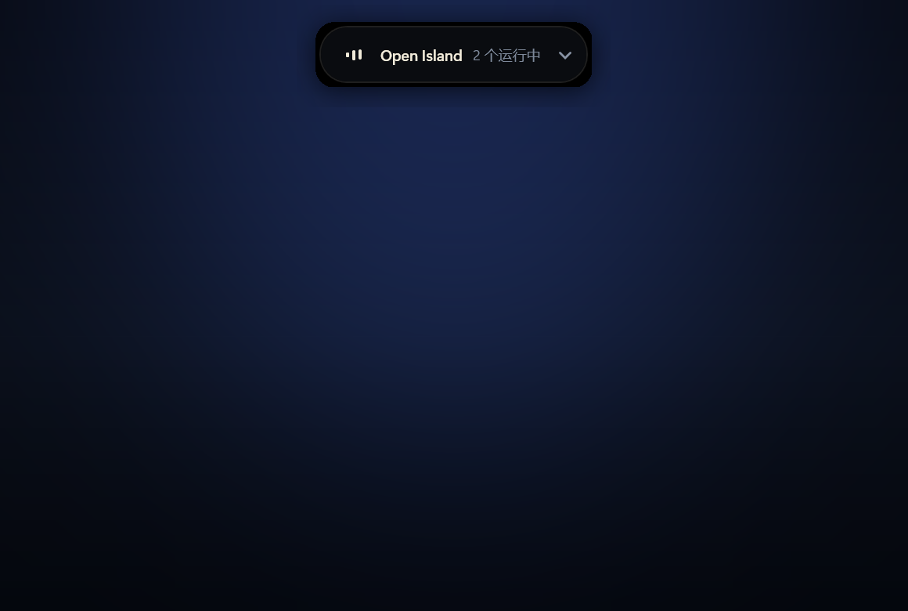
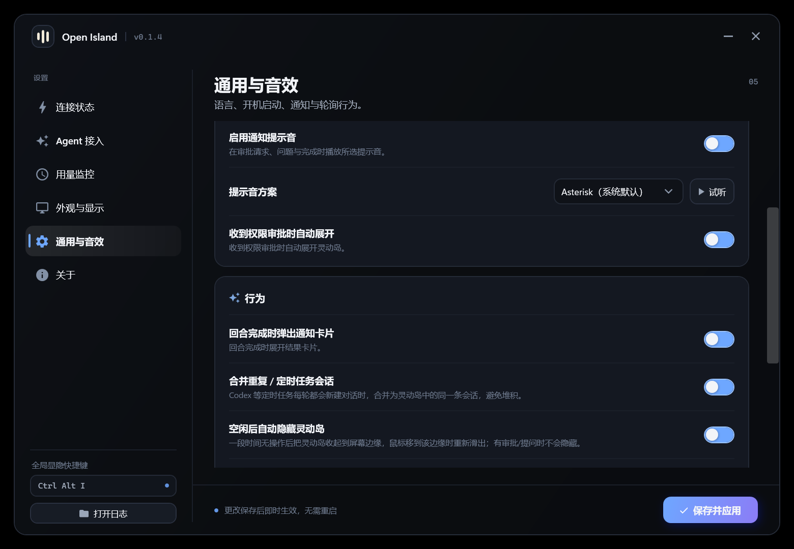
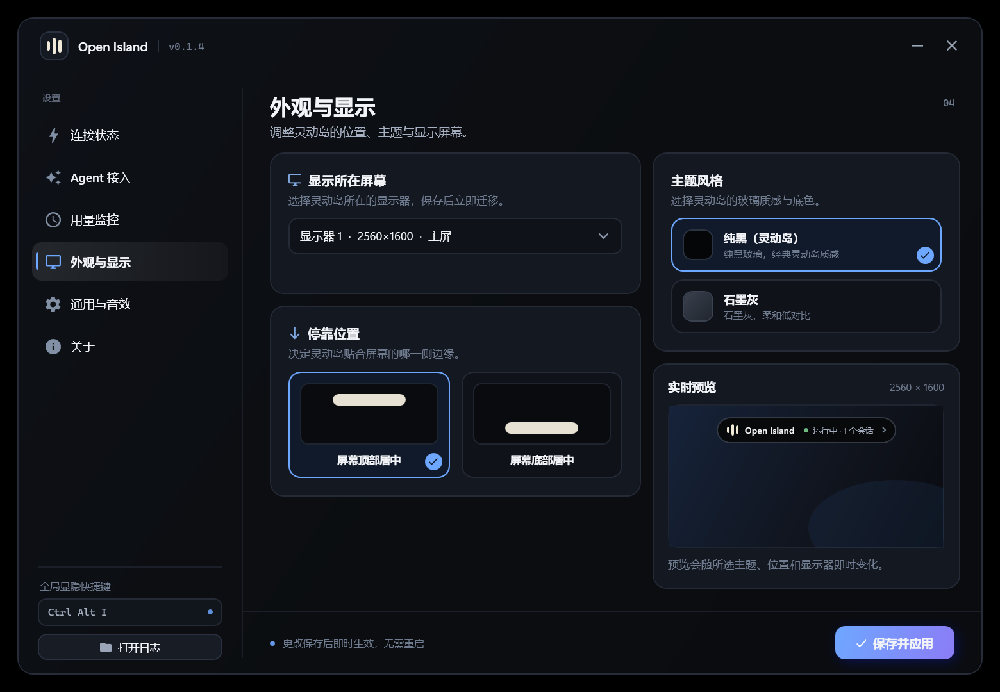

# Open Island — Windows 11 版

<p align="center">
  <b>为 AI 编程 Agent 打造的 Windows 灵动岛</b><br/>
  <sub>本项目是 <a href="https://github.com/Octane0411/open-vibe-island">Octane0411/open-vibe-island</a> 的 <b>Windows 11 移植版本</b>（Windows port），基于上游 macOS 版本的交互与视觉重新实现。</sub>
</p>

<p align="center">
  <a href="README.en.md">English</a> · 简体中文
</p>

<p align="center">
  
</p>

<p align="center">
  
  
</p>

---

## 这是什么

Open Island 把 AI 编程 Agent 的实时状态放进屏幕顶部的一枚「灵动岛」里：

- 谁在运行、在跑什么工具、最近一条回复；
- 什么时候需要你**批准命令 / 回答问题**；
- 一轮任务什么时候完成；
- 各个 Agent 的额度与用量。

它常驻桌面顶部、不占任务栏，平时是一条小胶囊；需要你操作时会主动展开。

> 本项目与 OpenAI、Anthropic、Google 等公司无隶属关系。所有 Agent 名称与商标归其各自所有者。

## 功能

- **实时 Agent 会话**：Claude Code、Codex、OpenCode、Cursor、Gemini CLI、Kimi、Grok、Hermes、Pi、Oh My Pi、Qoder、Qwen Code、Factory、CodeBuddy、ZCode 等；以及 **DeepSeek Harness（DSH）自动发现**（无需 Hook）。
- **审批 / 提问 / 完成通知**：需要你批准命令或回答问题时，灵动岛主动滑出并展开；支持提示音、自动展开开关。
- **点击跳转到对话**：Codex 直接打开对应 `codex://threads/<id>` 会话，或 `codex resume`；Claude 支持 `claude --resume`；DSH 点击聚焦 DSH 窗口。
- **空闲自动隐藏**：一段时间无操作后收起到屏幕边缘，鼠标移到边缘自动唤出；有审批/提问时不会隐藏。
- **用量监控**：Claude Code 5 小时 / 7 天额度等。
- **会话去重**：Codex 定时任务、子代理与 Guardian review 线程不会在岛上堆积；重复任务自动合并。
- **安全地安装 Hooks**：Codex 使用官方 `hooks.json`（兼容 ChatGPT/Codex App），启动时自动迁移旧配置，不会写坏 `config.toml`。
- **应用内自动更新**：启动时自动检查 GitHub Releases 最新稳定版，下载前严格校验 `SHA256SUMS.txt`（SHA-256），同时支持安装版（静默覆盖升级）与便携版 ZIP 原地更新，并可在设置中开关自动检查或随时手动检查更新。
- **中英双语界面**、深色主题（纯黑 / 石墨灰）、顶部 / 底部停靠、多显示器选择、全局快捷键 `Ctrl+Alt+I`。

## 界面

| 灵动岛 · 审批与多 Agent 会话 | 设置 · 行为 |
| --- | --- |
|  |  |

| 设置 · 外观 |
| --- |
|  |

## 安装

**系统要求**：Windows 10 / Windows 11 x64。

1. 打开 [Releases](https://github.com/zhengbaiyang/open-vibe-island-win11/releases) 下载：
   - `OpenIsland-Setup-0.1.4-win-x64.exe`：安装包（自包含，无需预装 .NET，按当前用户安装）；
   - 或 `OpenIsland-0.1.4-portable-win-x64.zip`：便携版，解压即用。
2. 安装包由个人签名构建，首次下载运行时 Windows 可能提示「Windows 已保护你的电脑」：
   - 右键安装包 → **属性** → 勾选 **解除锁定** → 确定，再运行；
   - 或下载 `OpenIsland-0.1.4-smartscreen-helper.zip`，按里面的说明运行 `Unblock-and-Install.cmd`。
3. 如果安装时报「无法创建目录 …\Temp\is-*.tmp（错误 5: 拒绝访问）」，说明用户临时目录权限异常：使用助手包中的 `Unblock-and-Install.cmd`（会自动改用可写临时目录），或直接使用便携版。
4. 打开 **设置 → Agent 接入**，为正在使用的 Agent 点击「安装 / 修复」以接入 Hooks。Codex 若提示信任 Hook，请在 Codex 中执行一次 `/hooks` 确认。

**自动更新**

- Open Island 会在启动时自动向 GitHub Releases 检查最新稳定版（可在 **设置 → 常规** 中关闭「自动检查更新」，或在 **设置 → 关于** / 托盘菜单中点击「检查更新」手动检查）。
- 下载更新包前会严格校验 Release 附带的 `SHA256SUMS.txt`（SHA-256 哈希不匹配或缺失时将拒绝执行）。
- **安装版**会自动执行静默覆盖升级并重启；**便携版**会自动校验并解压替换当前目录文件后重启；**开发构建**则直接打开 Release 页面供查看。

## 编译与运行

**依赖**

- [.NET 8 SDK](https://dotnet.microsoft.com/download/dotnet/8.0)
- [Inno Setup 6](https://jrsoftware.org/isdl.php)（仅生成安装包需要）
- Windows 10/11 SDK（可选，若使用代码签名）

```powershell
git clone https://github.com/zhengbaiyang/open-vibe-island-win11.git
cd open-vibe-island-win11

# 开发构建（输出到 dist\win-x64）
.\scripts\build.ps1

# 运行
.\dist\win-x64\OpenIsland.exe

# 安装 / 检查 Hooks
.\dist\win-x64\OpenIslandSetup.exe status
.\dist\win-x64\OpenIslandSetup.exe install claude
.\dist\win-x64\OpenIslandSetup.exe install codex
```

**生成发布产物**

```powershell
# 默认从 Directory.Build.props 读取版本号；也可传入 -Version 0.1.5 覆盖
# 自包含、无需目标机安装 .NET
.\scripts\package.ps1 -PortableZip

# 产物：
#   dist\OpenIsland-Setup-<版本>-win-x64.exe
#   dist\OpenIsland-<版本>-portable-win-x64.zip
#   dist\OpenIsland-<版本>-smartscreen-helper.zip
#   dist\SHA256SUMS.txt
```

- **手动发布**：上传 GitHub Release 时，**必须把上面全部 4 个文件（包括 `SHA256SUMS.txt`）作为 assets 一起上传**——应用内自动更新会严格校验 `SHA256SUMS.txt`。
- **自动发布（推荐）**：直接推送 `vX.Y.Z` 标签（例如 `git tag v0.1.5 && git push origin v0.1.5`），或在 GitHub Actions 中手动触发 **Release** 工作流（`.github/workflows/release.yml`），会自动完成构建、打包、SHA-256 校验并发布包含全部 4 个文件的 GitHub Release。

## 架构与目录

```
src/
  OpenIsland.App/       WPF 灵动岛 UI、设置窗口、托盘
  OpenIsland.Core/      会话状态、Hook 协议、发现、安装管理、桥接、自动更新
  OpenIsland.Hooks/     Agent Hook 命令行接收器
  OpenIsland.Setup/     OpenIslandSetup CLI（安装/检查/卸载 Hooks）
plugins/                OpenCode / Pi / Oh My Pi 扩展
installer/              Inno Setup 脚本与图标
scripts/                build.ps1、package.ps1
.github/workflows/      GitHub Actions 自动构建与发布工作流
docs/screenshots/       README 截图与演示动图
```

Agent 事件通过命名管道 `\\.\pipe\open-island-bridge` 推送到 App，UI 只消费统一的 `SessionStateReducer`。

## 后续计划

- 考虑更多自定义展示元素的加入（包括：媒体、日期、天气等）。

## 致谢与许可

- 上游项目：[Octane0411/open-vibe-island](https://github.com/Octane0411/open-vibe-island)（macOS 原版，SwiftUI）
- 本项目遵循 **GNU GPL-3.0**，详见 [LICENSE](LICENSE)。
- 感谢所有 Agent 工具与开源社区。

---

<p align="center"><sub>如果这个项目对你有帮助，欢迎点一个 ⭐ Star。</sub></p>
